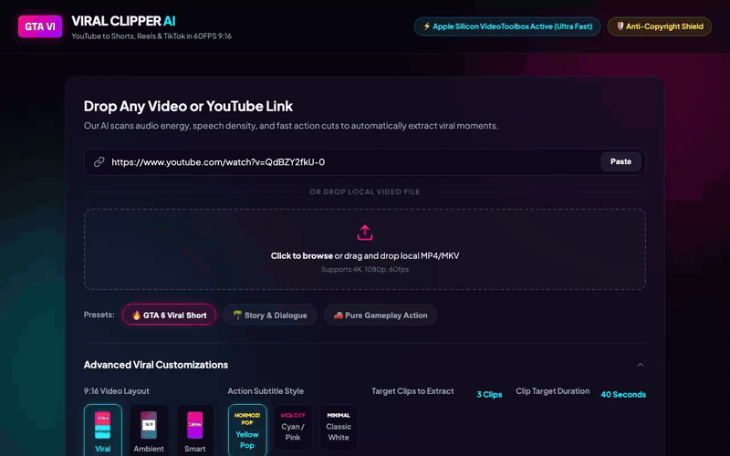

# 🌴 OpenShorts AI

> **Autonomous AI Video Clipping Engine for YouTube, Gaming & Viral Content**  
> Turn long YouTube videos, trailers, and gameplay walkthroughs into viral 9:16 vertical shorts (Reels, Shorts, TikTok, Rumble) with Hormozi-style animated karaoke subtitles, anti-copyright transformative shields, and SEO-proof metadata packages.

<div align="center">
  
  <p><em>⚡ Autonomous Web Dashboard: YouTube Ingestion &bull; Live Pipeline Progress &bull; 9:16 Split &amp; Blur &bull; Alex Hormozi Karaoke Subtitles &bull; 1-Click SEO Packages</em></p>
</div>

---

## ⚡ Key Features

- **🌐 Localhost Web Dashboard (Run on Any Port)**: Sleek Vice City Neon dark-mode dashboard with YouTube link dropping, local drag-and-drop file upload, live progress bar, and built-in video player.
- **🧠 AI Virality & Peak Action Detector**:
  - **Audio Energy**: Analyzes EBU R128 loudness spikes, explosions, engine revs, and laughter peaks.
  - **Scene Cut Detection**: Scans camera cuts and action velocity with FFmpeg `select='gt(scene,0.35)'`.
  - **Speech & Keyword Density**: Scores segments on viral keywords (*lucia, leak, secret, reveal, insane, vice city*).
  - **💬 Audience Reaction & Comment Heatmap**: Automatically parses YouTube comments & live chat for timestamp references (`14:20`, `1:05:30`) and crowd excitement keywords (*bam, amazing, cool, insane, clutch, holy, pog*).
  - **3-Second Hook Rule**: Prioritizes moments with immediate high-impact opening frames.
- **⏱️ Long Stream Section Targeting (4h+ Gameplay / Walkthroughs)**:
  - Choose video focus sections: **First Half (0-50%)**, **Middle (25-75%)**, **Last Half (50-100%)**, or **Full Video**.
  - Smart section streaming downloads only the targeted high-action window without needing gigabytes of entire 4-hour recordings.
- **🛡️ Anti-Copyright & Content ID Transformative Shield**:
  - Micro-tempo adjustment (`1.03x`) and pitch modulation (breaks acoustic audio fingerprinting).
  - Subtle cinematic color grading (`curves`, `contrast=1.07`, `saturation=1.10`) and edge vignette.
  - 9:16 vertical re-framing (Split screen, ambient blur, or dynamic crop) for complete fair use transformation.
- **✨ Action Subtitles (Alex Hormozi & Vice City Neon Style)**:
  - High-contrast, bold uppercase typography with thick black stroke outlines.
  - Dynamic active word karaoke highlighting (Electric Yellow `#FFE500` or Vice Cyan `#00F0FF`).
  - Zero-lag video burning with Apple Silicon `h264_videotoolbox` hardware acceleration.
- **📱 SEO & Multi-Platform Metadata Generation**:
  - **Instagram Reels**: Curiosity hook, high-converting caption, and 25 targeted hashtags.
  - **YouTube Shorts**: High-CTR viral title (< 55 chars, emojis, `#shorts`), SEO description, and 15 tags.
  - **TikTok**: Snappy punchline caption with trending sound recommendations.
  - **Rumble**: Evergreen organic search title and detailed gaming tags.
- **🤖 Antigravity Integration**: Pre-configured with `.agents/skills/gta-clipper/SKILL.md` and rules.

---

## 🛠️ Open-Source Tech Stack

Component | Open-Source Tool | Purpose
:--- | :--- | :---
**Downloader** | `yt-dlp` | Fetches high-res 1080p/4K YouTube streams & automated transcripts.
**Audio Engine** | `faster-whisper` | Extracts word-level timestamped transcripts using CTranslate2 & Apple Silicon NEON.
**Video Processing** | `FFmpeg` (VideoToolbox) | Rapid 9:16 reframing, scene detection, audio loudness analysis, and hardware encoding.
**Subtitle Typography** | `Pillow` & `Remotion` | Generates kinetic animated karaoke subtitle overlays.
**Backend & SSE** | `FastAPI` & `Uvicorn` | High-performance async server with Server-Sent Events for real-time progress.
**Frontend** | HTML5 / CSS3 / ESModules | Cyberpunk / Vice City responsive glassmorphic dashboard.

---

## 🚀 Quick Start

### 1. Launch the Localhost Web UI

Run the automated launcher script (selects an available port or pass your preferred port):
```bash
./start.sh 8000
```
Or start directly with Python:
```bash
python3 server.py --port 8000
```
Open **`http://localhost:8000`** in your browser.

---

### 2. Run via Command Line (CLI)

You can clip any YouTube video or local file directly:
```bash
# Basic usage
python clip_cli.py --url "https://www.youtube.com/watch?v=QdBZY2fkU-0"

# Custom options: 4 clips, 45 seconds each, split-screen layout
python clip_cli.py \
  --url "https://www.youtube.com/watch?v=QdBZY2fkU-0" \
  --clips 4 \
  --duration 45 \
  --layout split \
  --subtitles hormozi
```

CLI Parameters:
- `--url`, `-u`: YouTube link or path to local video file.
- `--clips`, `-c`: Number of viral clips to extract (default: `3`).
- `--duration`, `-d`: Target length per clip in seconds (default: `40`).
- `--layout`, `-l`: `split` (Top: GTA 6, Bottom: Gameplay), `blur` (Ambient Blurred 9:16), or `crop` (Smart Center Crop).
- `--subtitles`, `-s`: `hormozi` (Yellow pop), `vice_city` (Cyan/Pink), or `clean` (White).
- `--section`: Focus section for long streams (`full`, `first_half` 0-50%, `middle` 25-75%, `last_half` 50-100%).
- `--no-anti-copyright`: Turn off anti-copyright filters.
- `--json`: Output pure JSON for API pipelines.

---

### 3. Remotion Studio (Optional React Workflow)

For users who prefer rendering through Remotion React components:
```bash
cd remotion
npm install
npm start
```
This boots up Remotion Preview Studio at `http://localhost:3000` where you can tweak keyframe animations, fonts, and layouts visually.

---

## 📂 Project Structure

```
openshorts/
├── assets/
│   ├── demo.gif                   # Animated dashboard walkthrough demo
│   ├── demo.mp4                   # Full HD demo video with synchronized audio
│   └── gameplay/                  # Secondary gameplay footage library
├── backend/
│   ├── app.py                     # FastAPI server & SSE streaming
│   ├── config.py                  # Presets, hardware encoder detection
│   ├── pipeline.py                # End-to-end clipping orchestrator
│   └── modules/
│       ├── downloader.py          # yt-dlp downloader & section streamer
│       ├── transcriber.py         # faster-whisper word-level speech engine
│       ├── analyzer.py            # AI audio loudness & scene change virality scorer
│       ├── comment_analyzer.py    # Audience comment timestamps & excitement buzz analyzer
│       ├── reframer.py            # 9:16 layout generator (Split, Blur, Crop)
│       ├── anti_copyright.py      # Transformative pitch/tempo/color grade shield
│       ├── subtitles.py           # Hormozi/Vice City animated karaoke subtitles
│       └── seo_generator.py       # Multi-platform SEO packages (Insta, Shorts, TikTok, Rumble)
├── ui/
│   ├── index.html                 # Vice City dark neon dashboard
│   ├── style.css                  # Responsive Cyberpunk glassmorphic styling
│   └── app.js                     # Dynamic progress tracker & video player
├── scripts/
│   └── record_demo.py             # Playwright browser demo recorder script
├── remotion/                      # Remotion React component template
│   ├── package.json
│   ├── remotion.config.ts
│   └── src/
│       ├── Root.tsx
│       ├── GTA6ViralShort.tsx
│       └── Subtitles.tsx
├── .agents/                       # Antigravity Integration
│   ├── skills/
│   │   └── gta-clipper/
│   │       └── SKILL.md           # Antigravity skill definition
│   └── rules/
│       └── gta_clipping_rules.md  # Virality & copyright compliance rules
├── storage/
│   ├── downloads/                 # Downloaded source videos
│   ├── temp/                      # Processing cache
│   └── exports/                   # Final rendered viral 9:16 clips
├── clip_cli.py                    # Direct command line tool
├── server.py                      # FastAPI server runner
├── start.sh                       # One-click launcher script
└── requirements.txt
```

---

## 📜 Fair Use & Transformative Disclosure

This tool is designed to produce transformative commentary, highlight montages, and educational game breakdowns under Fair Use principles:
1. Significant alterations in format (16:9 landscape to 9:16 vertical split/blurred framing).
2. Curated editorial selection of peak action moments and dialogue hooks.
3. Original kinetic subtitle typography and synchronized text overlays.
4. Transformative audio equalization and visual grading.

